# Half Switch

This is a pure Verilog implementation of a Layer 2 Ethernet splitter (Half
Switch). It lets the programmable logic and the processing system share a single
MAC and physical link. It uses a 64-bit AXI-Stream interface intended for a
10 Gb/s Ethernet link.

## Usage

### IP-XACT

This repository contains IP-XACT metadata. Add the `ip` folder as an IP
repository in Vivado. See instructions [here](https://docs.amd.com/r/en-US/ug1119-vivado-creating-packaging-ip-tutorial/Add-the-IP-Repository).

### Verilog

Add all Verilog sources to your project:

    lib/eth/lib/axis/rtl/priority_encoder.v
    lib/eth/lib/axis/rtl/arbiter.v
    lib/eth/lib/axis/rtl/axis_fifo.v
    src/mac_arb.sv
    src/mac_read_address.sv
    src/mac_splitter.sv
    src/mac_half_switch.sv
    src/mac_half_switch_wrap_2.v

### Connections

Connect `m_axis_tx` and `s_axis_rx` to the MAC. Connect `s00_axis_tx` /
`m00_axis_rx` and `s01_axis_tx` / `m01_axis_rx` to the upper OSI layers; pair
each index (for example, `00` with `00`, `01` with `01`) on the same logical
path.

## Contributors

The switch was developed by Tim Frey (2026) and builds on Alex Forencich's
[`verilog-ethernet`](https://github.com/alexforencich/verilog-ethernet)
library, published under the MIT License. The submodule used in this project is based on vmayoral's fork for the AMD Kria KR260.

The project was created during Tim Frey's master's thesis at ETH Zürich.

## Citation

If you use the Half Switch in your work, please cite this repository. Formal
citation metadata will be added in a future release.

## License

| Content | License |
|---|---|
| Hardware design files (`src/`, `ip/`) | [Solderpad Hardware License v0.51](LICENSES/SHL-0.51.txt) (`SHL-0.51`) |
| Test software and tooling | [Apache License 2.0](LICENSES/Apache-2.0.txt) (`Apache-2.0`) |
| Documentation, diagrams, and repository metadata | [Creative Commons Attribution 4.0](LICENSES/CC-BY-4.0.txt) (`CC-BY-4.0`) |

The per-file
license mapping is in [`REUSE.toml`](REUSE.toml).
